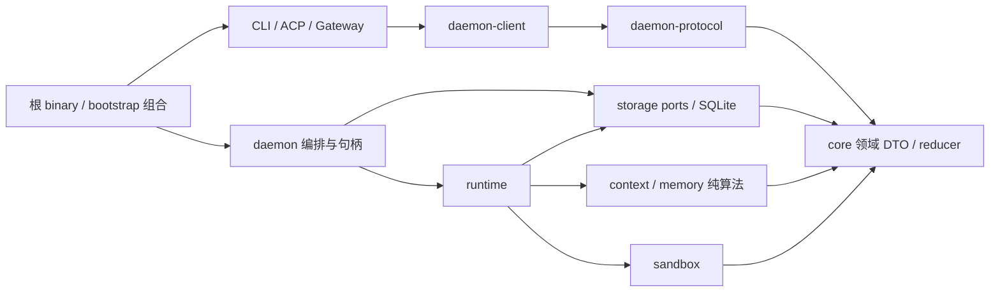

# Agent Runtime 架构与企业边界

基线 `0af445b`，2026-10-07。Local 已实现；Wave1-S1 接入 Local 可信身份/授权事务（[报告](docs/enterprise/wave1-s1-report.md)、[v21](docs/enterprise/schema-v21.md)）；Enterprise 是逐波待实施目标，不能以本文件代替运行证据。当前能力与 13 项确认见 [基线证据表](docs/enterprise/baseline.md)，逐表职责见 [SQLite v20](docs/enterprise/schema-v20.md)，需求映射见 [traceability](docs/enterprise/traceability.md)。

## 当前依赖与状态所有权

完整真实生产 Cargo 边（包括 runtime 当前复用 daemon-protocol 事件的边）见 [crate-boundaries.toml](docs/enterprise/crate-boundaries.toml) 与 [源码索引](docs/enterprise/baseline-index.md)。管理面独立模块尚未实现。storage ports 当前与 SQLite 同 crate；以后提取 ports 要有真实异步 backend 调用者，不能预建空 trait 或借 facade 掩盖 concrete 依赖。

| 状态 | 唯一业务事实 owner | 允许的临时状态 |
|---|---|---|
| session / lifetime / routing / transcript | SQLite SessionRepository | SessionSupervisor writer mutex/实例；每 turn disposable overlay |
| run / turn / queue / terminal | 同一 RunRepository/TurnRepository | RunCoordinator task/cancel token/replay；不持影子终态 |
| interaction / approval decision | interactions revision CAS | ApprovalBroker oneshot 唤醒；先持久 claim 再唤醒 |
| plan / compact / request capture | 同一 plans/context/request transaction | pure assembler/candidate/Effective execution instance |
| delegation | 同一 delegations + child native runs | 子 tasks/等待器；不建入口 child 状态机 |
| background Resource | ResourceRepository | daemon 真实 Child/process handle；日志来自监督者 |
| events / readback version | SQLite event/stamp/snapshot_clock | client/Web ViewReducer、broadcast、live cursor |
| memory / hook receipts | 同一 Memory/Hook repository | 有界维护任务和执行配置；不是统一企业审计 |
| cron definitions | Local CronStore/cron.json（已审计例外） | 已持久状态的内存 cache；native run 仍为 SQLite |
| Skill/MCP/Provider/Hook config | Local 文件/环境/SecretStore 适配 | manager 动态实例/catalog cache；尚未有 registry generation |

禁止入口直接依赖 storage/runtime/daemon/sandbox/数据库，禁止 runtime 反向依赖 daemon/入口，禁止 core 基础设施依赖，禁止 Provider 承担 tool schema、安全、审批与执行业务。SQLite/PG implementation 不互相依赖；Gateway 不查具体数据库。根 bootstrap 通过实际 CommandHost/GatewayHost 注入环境和启动能力，不授权入口持有业务 owner。

## 两种部署模式与两种 API 面

Local：一个工作区 daemon、UDS、SQLite；无 PG/OIDC/K8s 也能运行。binary/CLI/TUI/env/config/socket/HTTP/WS/ACP 默认行为向后兼容。现有数据只有明确离线迁移才转换，不能因开启配置自行变成多租户。

Enterprise 目标：management plane 管理 org/tenant/project/agent/policy/quota/registry/release/audit；access plane 做身份验证、tenant routing/限流；runtime plane 单 session writer worker；PG canonical facts + ArtifactStore；extension plane 信任/签名/generation；observability plane OTLP/审计链/费用账本。二者选同一领域端口实现，不双写，不保留两套 run/session/approval/plan/MCP/cron owner。

管理 API 独立 audience/scope、入口路由/部署配置，不挂到普通会话 token 的权限集。使用 API 只有 session/prompt/approval/cancel/stream 等资源 action。token 给出可信主体事实，daemon/policy owner 最终授权；客户端 tenant 字段/channel label/模型输出/prompt 均不能授予权限或覆盖认证上下文。

## 写入与资源硬约束

1. 所有 business mutation 在事务内部复核 current lifetime/run generation/turn/revision。企业加入 scope/policy/lease epoch，不能用一次进程外比较替代。operation_id 相同 payload 幂等，不同 payload conflict；现有旧命令不全都有独立 operation_id，逐波补齐，不声称已全部满足。
2. 终态只从 canonical commit 发布。EOF、ACK、popup 消失、client detach、慢消费者、readback failure、心跳缺失均不能决定业务成功/失败/批准/拒绝/取消。transport overflow 只能断开或触发 resync。
3. 外部作用 prepared receipt → 调用 → terminal receipt；无法确定即 typed unknown/reconcile，不自动重放。纯读取或拥有可证明幂等键的操作才可按类型化 retry class 重试；不靠错误字符串猜测。
4. Provider 只解 wire；canonical ToolCallAssembler 完整组装，全批 schema/safety/trust/policy/backend admission 先于任何副作用。任何装配失败整批拒绝。
5. run admission 冻结 route/tool catalog/permission/sandbox/context；企业 snapshot 再冻结 principal/roles/policy version/scope/Agent generation。显式 revoke 另有持久决策；配置更新不追改在途事实。
6. 可替换配置/plugin/connector/worker 具备 generation，prepare/validate/publish 后才替换；旧代 drain。单 session lifetime 同时只有一个 writer lease，HA 接管基于 DB epoch 而非多个 ReAct 执行体。
7. background/foreground resource 同一 canonical Resource 状态族；stop/reconcile 带稳定 workload identity。不能凭 PID/name/namespace 拼字猜归属。worker 输出通过 artifact 发布，不写任意 hostPath。
8. 安全文件操作继续 directory fd、no-follow、identity/content CAS、原子 rename/fsync；Native 同 UID 软边界不得冒称强隔离。requested strong backend 不可用时 fail closed，禁止回退 Native。
9. 新生产队列必须有容量、背压/溢出语义与指标；分页/日志/目录/包/body/frame/output 受限。现存四项生产无界债只准精确登记，不准扩增；见 [通道预算](docs/enterprise/channel-budget.md)。异常不能通过静默丢参数、receipt 或 ProtocolDone 解决。
10. secret 引用化、最小权限、protected path/hard deny 永优先于 role auto-allow；审计/trace/logs 不保存 token/prompt/完整工具参数。当前脱敏仅若干本地合同，统一企业脱敏尚待 Wave 8。

## 协议与错误

Daemon JSON-RPC 2.0 framing、显式 protocol v1 + connection capability/schema 协商；legacy aliases 只 normalize 到同一个 handler。默认 ACP v1，`--acp-v2` 是物理 SDK v2 opt-in；缺 SDK 标准操作用已协商的 my-agent namespace。默认严格 DTO `deny_unknown_fields`，兼容入口保留已有行为；扩展字段必须协商，不能把 v2 身份塞进 v1 容错 metadata。单帧上限 4 MiB。

现存 storage RuntimeError 分类较少，跨入口 RPC 常使用 legacy 整数 code；**以下为企业待实现的统一错误合同**：Unauthenticated、Forbidden、TenantMismatch、Conflict、StaleOwner、StalePolicy、QuotaExceeded、RateLimited、Busy、Cancelled、DeadlineExceeded、ProviderUnavailable、ToolAdmission、ToolExecution、SandboxUnavailable、StorageUnavailable、ProtocolViolation、InteractionPending、UnknownOutcome、Internal。每类需 code/HTTP/JSON-RPC/A2A/retryable/安全自动重试/recovery_action/audit severity；未知结果永不能因 retryable 网络错误重放副作用。Unauthorized/跨 tenant/不存在资源使用一致外部投影，内部保留审计原因；内部 SQL/路径/凭据不外露。

协议能力协商不等于主体授权。未来 OIDC/API key/workload identity 先认证再进入可信 context；Local 主体映射由 server 建立。远程认证未实现前，不接受客户端自报 enterprise principal。

## 事务、锁序与故障恢复

既有次序：session lane/短 control barrier → SQLite connection mutex → transaction → facts + stamps → commit → broadcast/approval wakeup/Hook dispatch。禁止持 DB transaction 等外部 Provider/tool/connector/network I/O；执行体持 RAII writer permit。读回一个 read transaction，不从多时点查询拼 canonical snapshot。并发测试使用屏障/实际多连接/故障 trigger；不以 sleep 推断一致性。

PG 目标同一 transaction 复核 scoped owner/lease epoch/policy/receipt，业务写入与 outbox/audit/quota ledger 同事务；publisher 至少一次，消费者 event_id 去重。NOTIFY/cache/广播仅唤醒。未知 side effect 的 worker 接管必须先 reconcile，不因为 lease 过期自动重试外部调用。

迁移前备份/摘要/完整性检查，schema 只前进，未来版本 fail closed；expand/migrate/contract 和协议窗口显式声明。离线 SQLite→PG 逐表 count/digest 对账、marker 切换，不长期双写。K8s readiness 仅能接新流量；liveness 不依赖 Provider latency；preStop drain 有界，强杀保留 unknown evidence。

## 可执行门禁与证据等级

`tests/architecture_contract.rs` 保留原 12 项并新增 quality、typed mutable business owner、Cargo alias/target/build/inherit、全成员职责登记、channel RED/精确例外检查。原禁止边与 unsafe/unwrap/expect/stdout 检查加强而不撤销。所有新增 crate 自动纳入，登记职责不是实际完成证明。静态检查不能推导任意宏展开、反射 SQL 或跨文件任意别名，需 code review 和真实 transaction/authorization/故障合同共同证明。

文档区分 implemented / locally verified / CI verified / production verified / proposed；本轮所有新企业 ADR 是 proposed，Wave 0 门禁实现是 implemented，只有实际日志通过才标 locally verified。没有实际 CI/商业 Provider/IdP/Docker/K8s lane 不能写 verified。

完整发布门禁见用户规格与 [traceability](docs/enterprise/traceability.md)。全波通过才进下一波；按纵向切片包含 owner/DTO/schema/transaction/真实 daemon/协议/入口/restart/concurrency/security/运维证据。数据库/管理/worker/registry/audit/K8s 设计分见 ADR 0004–0009。

Wave2-S14 已登记 runtime→storage-ports 的具体依赖：纯 core async RunAttemptRepository 已由同 canonical RunStore 实现，foreground runtime 的 Started/terminal/usage/route event 真实 await。旧同步域接口仍在 SQLite crate，未称全业务端口已提取；禁止入口 concrete/database 和 PG→SQLite 反向边保持。
